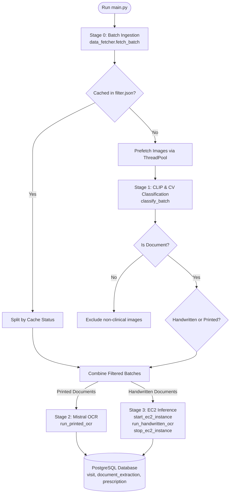
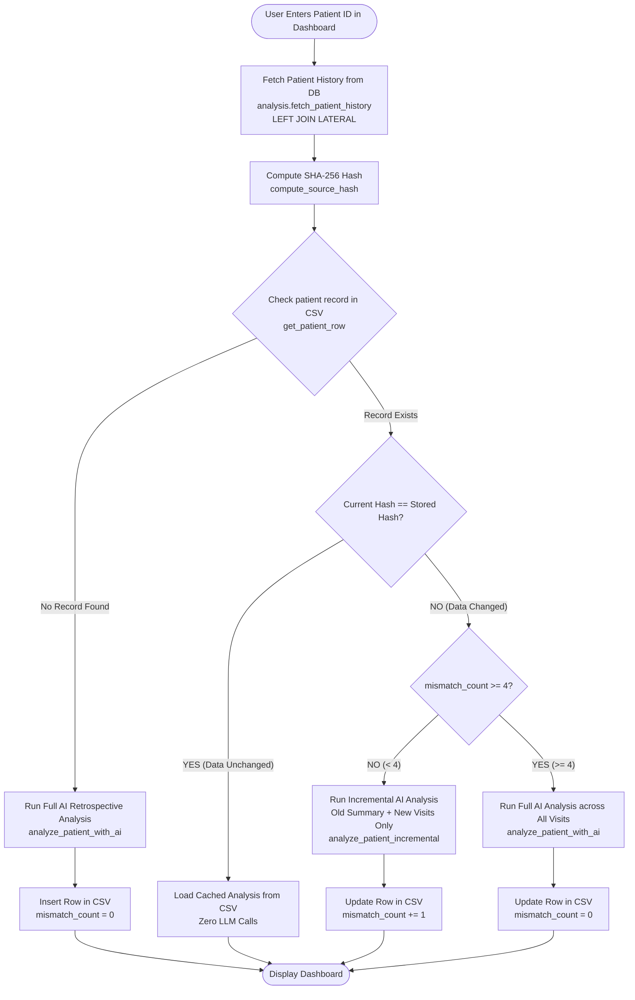

# Complete Architecture: Two-Stage System Pipeline

This system consists of two independent pipelines:
1. **Pipeline 1: Document Processing & Extraction Pipeline (`/`)** — Ingests raw clinical images, classifies them, extracts text/data via OCR, and writes structured records into PostgreSQL.
2. **Pipeline 2: Clinical Retrospective & Analytics Pipeline (`/dataanalysis`)** — Aggregates patient longitudinal history from PostgreSQL, optimizes AI usage using deterministic hashing & cache/delta logic, and serves a Streamlit dashboard.

---

## 1. Flowchart: Pipeline 1 (Ingestion, Classification & OCR)

---

## 2. Flowchart: Pipeline 2 (Clinical Analysis, CSV Cache & Dashboard)

---

## Module Overview

| Pipeline | Main Directory | Key Files | Function |
| :--- | :--- | :--- | :--- |
| **1. OCR Extraction** | Root (`/`) | `main.py`, `data/data_fetcher.py`, `preprocessing/clip_preprocessing.py`, `model/mistral_printed.py`, `model/handwritten.py` | Ingests images, filters non-documents, routes printed/handwritten to OCR engines, and stores extracted text in PostgreSQL. |
| **2. Analytics & Storage** | `dataanalysis/` | `analysis.py`, `Zai_analysis.py`, `storage/ai_analysis_csv.py`, `csv_dashboard.py` | Fetches consolidated visit history, tracks changes with SHA-256 hashes, maintains token-efficient CSV cache/upserts, and renders interactive dashboard. |

#	Group	Approx. patients	Typical diagnoses in your data
1	Skin / Hair	~7,600	eczema, tinea, xerosis, acne, scabies, melasma, urticaria, PMLE
2	Respiratory	~6,600	URTI, LRTI, cough/cold, flu, asthma, COPD
3	Musculoskeletal	~5,900	joint/knee pain, OA knee, LBA/LBP, DJD, spondylosis, myalgia
4	Cardiovascular (BP)	~4,000	HTN, HTN+T2DM, chest pain, CAD, dyslipidemia
5	Fever / Infection	~3,400	AFI, viral fever, herpes zoster, varicella
6	Gastrointestinal	~2,300	gastritis, gastroenteritis, GERD, IBS, pain abdomen, hemorrhoids
7	Diabetes / Thyroid	~2,100	T2DM, hypothyroidism
8	Weakness / Nutrition	~1,600	general weakness, anemia, nutritional
9	Neurological	~1,400	headache, vertigo, migraine, tension headache, neuropathy, radiculopathy
10	Women's health	~1,000	DUB, PCOS, amenorrhea, pregnancy, vulvovaginitis
11	Urinary / Sexual health	~500	UTI, STI
12	ENT	~420	CSOM, ear wax, pharyngitis, rhinitis
13	Injury / Wounds	~240	trauma, burn, abrasion
14	Mental health / Stress	~40	anxiety disorder
15	Eye / Dental	very few	none in the top diagnoses (shows up mostly in complaints)
About "tension": "tension headache" is in Neurological. The word "tension" on its own, meaning stress, goes in Mental health / Stress. Stress is rarely written as a diagnosis in your data, which is why that group is so small.

I also added a "Patient Type" card to the patient dashboard, just below the overview cards. It shows the patient's main group first, then the other groups with how many visits each appeared in. The new code hasn't been run or tested yet. The changes are: